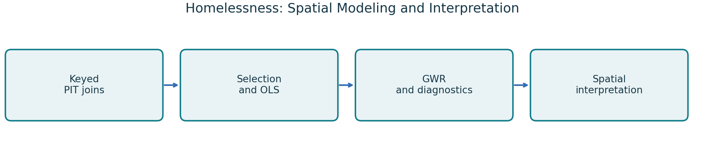
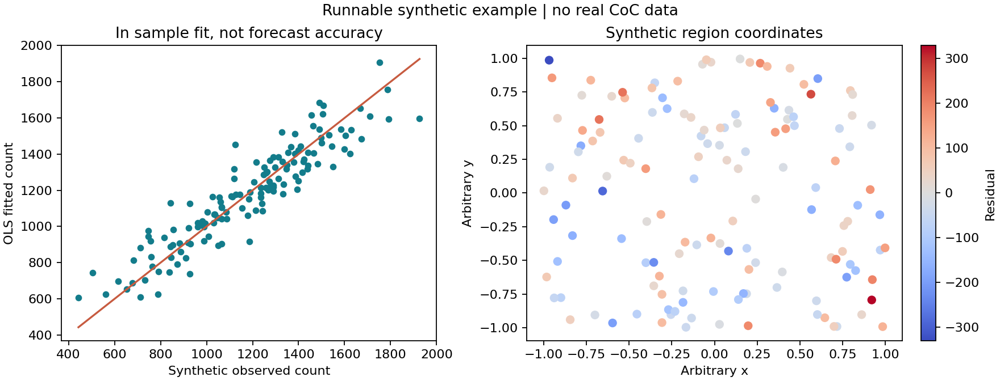

# Homelessness Prediction and Spatial Interpretation

**Python · ArcGIS Pro / ArcPy · OLS · GWR · Spatial diagnostics**

An ASU Quark Lab research project examining how relationships associated with homelessness vary geographically. The historical study covers **141 Continuum of Care regions across 17 Eastern and Northeastern jurisdictions**, using official **2021 Point in Time counts** and enriched regional predictors. This repository preserves the analysis and ArcPy cartography code alongside a small, runnable synthetic example.



The central question is interpretability: when does a global regression coefficient conceal a different local relationship? The project compares ordinary least squares with geographically weighted regression, then examines residual spatial clustering, coefficient reversals and robustness. The word prediction in the project title does not establish prospective forecasting accuracy.

## Start in five minutes

Python 3.11 is the validated version. From the repository root:

```bash
python -m venv .venv
# Windows: .venv\Scripts\activate
# macOS/Linux: source .venv/bin/activate
python -m pip install -r requirements.txt
python scripts/demo.py
python -m unittest discover -s tests -v
```

The demo creates 141 **synthetic** region records, fits a four-predictor OLS model and computes a nearest-neighbor residual Moran statistic with 199 seeded permutations. These settings are a lightweight illustration, not substitutes for the research specification. It writes `data/sample/regions.csv`, `outputs/demo/metrics.json` and the figure below. No research data, ArcGIS license, account or download is needed.



## Historical research design

1. Reconcile CoC identifiers between PIT outcomes, enriched attributes and HUD boundaries. Preserve companion shapefile files and inspect geographic coverage before joining.
2. Remove excluded and sparse predictors, inspect correlation and VIF, then apply the recorded backward-selection procedure. Data-driven selection must be considered when interpreting conventional p values.
3. Fit OLS for the primary outcome and repeat the selection workflow for shelter-category and unsheltered outcomes.
4. Project centroids appropriately for regional distance calculations and fit GWR with adaptive bandwidth selection. The recorded primary bandwidth is 53 neighbors.
5. Examine residual Moran's I using 9,999 permutations. The separate spatial variability exercise uses 1,000 coordinate permutations and reselects bandwidth.
6. Compare sign, significance and magnitude of global and local coefficients. Inspect influential regions, HC3 uncertainty, negative fitted counts, local collinearity and geometry sensitivity.
7. Export keyed spatial tables, feature classes, editable map projects, symbology and publication figures through ArcPy.

## Recorded findings and interpretation

| Historical result | Value | Interpretation |
|---|---:|---|
| Primary OLS R² | 0.918943733 | In sample explanatory fit |
| Primary GWR R² | approximately 0.9802 | In sample local fit; more flexible than OLS |
| Primary OLS RMSE | 1,634.79 | Recorded fitted-count error |
| Significant local Crime reversals | 7 CoCs | Recorded local interpretation difference |
| Significant local Tapestry reversals | 3 CoCs | Recorded local interpretation difference |

These are historical research outputs, not results produced by the synthetic demo. The primary specification uses Hispanic Pacific Islander population, civilian veteran population, Total Crime Index and Tapestry Segment 12D population. High fit does not establish causality, forecasting quality or policy effectiveness.

Important qualifications include mixed-year predictors, strong NY-600 influence, heteroskedasticity, residual spatial dependence, some negative fitted counts and local collinearity. Read these alongside the numerical results. Publication or acceptance of the homelessness manuscript has not been independently established; no unpublished manuscript is distributed here.

## Repository guide

| Path | Purpose |
|---|---|
| `scripts/demo.py` | Deterministic public OLS and residual spatial diagnostic |
| `research/Final.ipynb` | Research notebook, outputs cleared for public release |
| `scripts/export_paper_arcgis_maps.py` | ArcPy feature-class, map and layout workflow |
| `scripts/export_crime_arcgis_map.py` | Crime-related cartographic export |
| `scripts/draw_actual_moran_explainer.py` | Research teaching figure generator |
| `data/sample/` | Synthetic public input |
| `docs/REPRODUCIBILITY.md` | Research setup, data requirements and execution limits |
| `docs/PROVENANCE.md` | Attribution, provenance and source-copy policy |
| `tests/` | Key integrity, missingness, OLS arithmetic and permutation checks |

## Reproducing the research

The public example runs immediately. The complete research notebook requires the enriched input table, official PIT file, boundary companions and optional cached map evidence. These inputs are not publicly redistributed here. The Desktop copy contains ignored local input copies so an authorized researcher can build a separate workspace with `python scripts/prepare_research.py`. See [reproduction instructions](docs/REPRODUCIBILITY.md) before running expensive permutation work.

ArcPy is intentionally outside the portable sample dependencies. Use ArcGIS Pro's licensed Python and provide an appropriate APRX template for editable cartography. This repository does not claim ArcGIS Enterprise administration or a live cloud deployment.

## Attribution

Research by Vinay Vikkranth Subramanian with ASU Quark Lab and Dr. Asish Satpathy. Repository packaging and sample code were added separately to make the methods inspectable. See [NOTICE](NOTICE.md) before reuse. Contact: [Vinay on LinkedIn](https://www.linkedin.com/in/vinay-vikkranth/).
